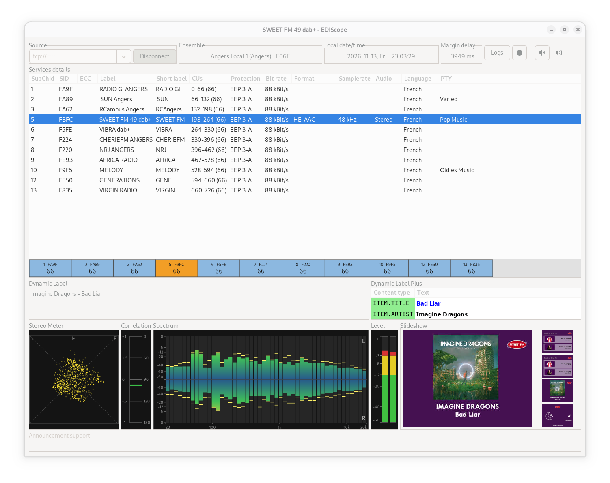

# EDIScope

EDIScope is a DAB/DAB+ ETI/EDI player and diagnostic tool, forked from
[DABlin](https://github.com/Opendigitalradio/dablin) by Stefan Pöschel.
Where DABlin is a general-purpose DAB/DAB+ receiver (live SDR reception,
ETI playback, EDI playback), EDIScope narrows and extends that scope
specifically around **EDI**: receiving, timing and inspecting an
ODR-DabMux EDI output live over the network, with real-time pacing and
on-screen diagnostics (buffering margin, live ensemble changes, CU
occupancy, etc.) that upstream DABlin does not have.

Both a console (`ediscope`) and a GTK GUI (`ediscope_gtk`) version are
built.

## Screenshots

### GTK GUI version



## What EDIScope adds over upstream DABlin

This section lists everything that has been added, changed or removed
in this fork, on top of stock DABlin:

* **EDI network input.** Connect directly to a live TCP or UDP (uni- or
  multicast) EDI source from the GUI's "Source" box (with PFT/Reed-Solomon
  FEC fragment reassembly handled transparently), or from the command
  line with `-f edi`. The GUI remembers the last URIs you connected to
  (`~/.config/ediscope/network_history`) and can switch to a different
  mux at any time without restarting - including switching away from
  whatever was initially given on the command line. See
  [EDI network input](#edi-network-input).

* **Real-time EDI timestamp pacing and diagnostics.** Each EDI frame's
  embedded ATST/TIST timestamp is decoded and used to play every frame
  at exactly its own scheduled time (rather than just draining the
  stream as fast as it arrives), and the GUI shows the current
  **margin delay** (how far ahead of schedule the network is actually
  delivering frames) live, with the mux's `TIST@FCT0` configuration
  value available as a tooltip. See
  [EDI timing diagnostics](#edi-timing-diagnostics).

* **Live ensemble/service monitoring.** The old service drop-down is
  replaced by a sortable **services table** (SubChId, SID, ECC, label,
  short label, CUs, protection, bit rate, format/samplerate/audio mode,
  language, PTY), a **CU occupancy bar** (864 CUs/CIF) with click-to-play
  and SubChId/SID labels, a live **ECC → country** lookup, and a
  **log window** recording every hot change to the ensemble (services
  and sub-channels added/removed on the fly, label/protection/bit rate
  changes, etc.) with automatic timeout-based removal of services that
  disappear from FIG 0/2. See
  [Services table, CU bar and ensemble log](#services-table-cu-bar-and-ensemble-log).

* **More visualizations.** A frequency **spectrum analyzer** (bubble or
  bar style, mono or stereo), a stereo **vectorscope/goniometer**, a
  phase **correlation meter**, and a peak **level meter** are shown
  alongside Dynamic Label and the Slideshow, which are now embedded
  directly in the main window instead of floating windows.

* **Slideshow history.** The last 4 slides are kept as a vertical strip
  of thumbnails next to the current slide (sized to match its height),
  each with the same right-click menu as the current slide (save the
  original file, copy the image) plus a "View at normal size" option,
  and a tooltip with resolution/size/format/content name - so you don't
  lose a slide just because a newer one replaced it on screen.

* **No live DAB/RTL-SDR reception.** EDIScope intentionally does **not**
  include DABlin's built-in live DAB source support (RTL-SDR via a
  bundled `eti-cmdline`, or spawning an external `dab2eti`/`eti-cmdline`
  binary). It focuses on ETI and EDI *streams* - from a file, from
  `stdin`, or (for EDI) directly over the network - not on demodulating
  DAB off the air itself. If you need live SDR reception, pipe a
  live ETI-NI stream from an external tool into EDIScope instead (see
  [ETI/EDI live reception via pipe](#etiedi-live-reception-via-pipe));
  there is no `-d`/`-D`/`-c`/`-C`/`-g`/`-G` channel/gain/live-source
  option anymore.

* **Rebranded and packaged as its own app.** Renamed throughout from
  DABlin to EDIScope (binaries `ediscope`/`ediscope_gtk`, window titles,
  man pages, config directory), with its own icon embedded in the
  binary and a `.desktop` entry so it shows up correctly in a taskbar,
  dock or Alt-Tab switcher - not just as a bare terminal window.

The upstream copyright, license and the bulk of the original decoding
engine (ETI/EDI framing, DAB/DAB+ audio decoding, FIC/PAD/MOT parsing,
Dynamic Label(+), recording, announcements, hotkeys, status messages)
are unchanged and documented below as they still apply to EDIScope.


## Requirements

### General

Besides Git a C/C++ compiler (with C++11 support) and CMake are required to
build EDIScope.

On Debian or Ubuntu, the respective packages (with GCC as C/C++ compiler) can be
installed using aptitude or apt-get, for example:

```sh
sudo apt-get install git gcc g++ cmake
```


### Libraries

The following libraries are required:

* mpg123 (1.14.0 or higher)
* FAAD2
* SDL2

The GTK GUI version in addition requires:

* gtkmm 3

Usually the `glibc` implementation of `iconv` is available. If this is
not the case, in addition `libiconv` is required.

In rare cases, the target architecture does not support *atomics*. In
such a case, EDIScope is linked against GCC's `libatomic`. This lib
usually is an (indirect) dependency of GCC itself.

On Debian or Ubuntu, mpg123, FAAD2, SDL2 and gtkmm are packaged and installed
with:

```sh
sudo apt-get install libmpg123-dev libfaad-dev libsdl2-dev libgtkmm-3.0-dev
```

On Fedora, mpg123, SDL2, and gtkmm are all packaged and can be installed thus:

```sh
sudo dnf install mpg123-devel SDL2-devel gtkmm30-devel
```

FAAD2 is not packaged in the main Fedora repository, but it is available in
[RPM Fusion repository](https://rpmfusion.org/). Once you have added RPM Fusion
to the repositories, FAAD2 may be installed by:

```sh
sudo dnf install faad2-devel
```

If you do not wish to, or cannot, add the RPM Fusion repositories, you will have
to download FAAD2, perhaps from [here](http://www.audiocoding.com/faad2.html), and build
and install manually.


### Alternative DAB+ decoder

Instead of using FAAD2, DAB+ channels can be decoded with [FDK-AAC](https://github.com/mstorsjo/fdk-aac).
You can also use [OpenDigitalradio's fork](https://github.com/Opendigitalradio/fdk-aac), if already installed.

On Debian and Ubuntu, you can install FDK-AAC with:

```sh
sudo apt-get install libfdk-aac-dev
```

On Fedora, RPM Fusion is again needed and, if used, you can:

```sh
sudo dnf install fdk-aac-devel
```

When the alternative AAC decoder is used, the FAAD2 library mentioned
above is no longer required.

After installing the library, to use FDK-AAC instead of FAAD2, you have to
have `-DUSE_FDK-AAC=1` as part of the `cmake` command.


### Audio output

The SDL2 library is used for audio output, but you can instead choose to
output the decoded audio in plain PCM for further processing (e.g. for
forwarding to a streaming server).

In case you only want PCM output, you can disable SDL output and
therefore omit the SDL2 library prerequisite. You then also have to
have `-DDISABLE_SDL=1` as part of the `cmake` command.

To enable the raw PCM output to `stdout`, the `-p` parameter has to be used.

The PCM audio can also be prepended with a RIFF WAVE header using the `-w`
parameter instead. This uses the maximum value for length fields in order to
allow streaming. On any later audio format change (this also includes a service
change in the GUI version), a new RIFF WAVE header will be issued. As RIFF WAVE
requires samples to be in Little Endian (LE) order, this feature only makes
sense on a LE platform.

It is also possible to disable the output of any decoded audio and
instead output the current service as an untouched MP2/AAC stream to
`stdout`. This can be achieved by using the `-u` parameter.


### Surround sound

Services with surround sound are only decoded from their Mono/Stereo
core, as unfortunately there is no FOSS AAC decoder which supports the
required Spatial Audio Coding (SAC) extension of MPEG Surround at the
moment.


## Compilation

If the gtkmm library is available both the console and GTK GUI
executables will be built, otherwise only the console executable will be
built.

From this repository's root:

```sh
mkdir build
cd build
cmake ..
make
sudo make install
```

This produces `src/ediscope` (console) and, if gtkmm was found,
`src/ediscope_gtk` (GTK GUI).


### EDI network input

In the GTK version's "Source" box, enter an EDI URI and click "Connect":

* `tcp://host:port`
* `udp://host:port` (unicast)
* `udp://mcast-ip:port` (multicast)

PFT fragments (ETSI TS 102 821 Annex B), if used by the sender, are
reassembled transparently, including Reed-Solomon FEC correction of
missing fragments. The last 10 URIs you connected to are remembered
across restarts (`~/.config/ediscope/network_history`). Clicking
"Disconnect" (or connecting to a different URI) stops the current
source and switches over cleanly, whether it was a network source, a
file, or `stdin`.

From the console version, use `-f edi` with a TCP/UDP stream piped or
redirected into it (see
[ETI/EDI live reception via pipe](#etiedi-live-reception-via-pipe)
for examples) - there is no interactive network UI on the console.


### EDI timing diagnostics

An EDI stream normally carries an accurate timestamp (ATST, inside the
`deti` TAG item's TIST/FCT fields) with every frame, set by the mux to
some configured amount of time (`tist_offset`) ahead of when the frame
is actually meant to be played. EDIScope decodes this timestamp and
paces playback against it directly: each frame is held until its own
scheduled time, rather than being played back as fast as it arrives.
A frame that is already due by the time it's received (e.g. an old
frame replayed in a mux's initial TCP preroll burst) is dropped instead
of being rushed through, so reconnecting to a mux doesn't cause a burst
of fast-forwarded, glitchy audio.

The GTK version's "Margin delay" box shows, live, how far ahead of its
own schedule the network is currently delivering frames - this should
settle close to (but just under) zero minus the mux's `tist_offset`,
net of real network latency, and will naturally jitter with it. Hovering
over the box shows the `TIST@FCT0` value observed on the wire (the
fractional-second part of the timestamp at FCT 0), letting you verify a
mux's `tist_at_fct0` configuration directly from the stream. The
console version prints the same two figures, plus the actual end-to-end
buffering delay once each frame is played, to `stderr`.


### Services table, CU bar and ensemble log

The GTK version's "Services details" table lists every service
currently in the ensemble (SubChId, SID, ECC - with a country name
looked up when known, label, short label, CUs, protection, bit rate,
format/samplerate/audio mode, language, PTY), sortable by any column.
Below it, the CU occupancy bar shows all 864 CUs/CIF, labelled by
SubChId/SID and colour-coded by sub-channel; clicking a segment plays
that service directly. Both are locked (insensitive) while a recording
is in progress, so the service being recorded can't be switched away
from by mistake.

Services and sub-channels that disappear from FIG 0/2 are automatically
removed after a timeout, rather than lingering forever. The "Logs"
button opens a separate window recording every such hot change to the
ensemble as it happens - services or sub-channels appearing/disappearing,
label changes, protection/bit rate changes, etc. - which is otherwise
easy to miss on a live mux.


### Date/Time

The console version shows the related parameters as they are received:
While the Local Time Offset (LTO) is shown upon any change, the UTC
date/time is shown once (or once again on precision change).

The GTK version in contrast starts to display the local date/time as
soon as both mentioned values have been received. The used clock is then
resynchronised upon further received UTC date/time.

If an ensemble transmits both short (minute precision) and long (millisecond
precision) form, only the long form will be used, as soon as received for the
first time.


### Announcement support/switching

In terms of announcement support/switching the console version shows the
separate details. The GUI combines the received data and in general
shows which announcements the current service supports.

During a matching announcement, the corresponding type is highlighted in
yellow. An announcement that would lead to a (temporary) switch to a
different subchannel leads to cyan highlighting instead e.g. if traffic
news of a different channel shall affect also listeners of a different
service (which does not have its own announcements).

The GTK version indicates an active alarm announcement on ensemble level
by the suffix "Alarm" after the ensemble label, highlighted in red.


### Hotkeys (GTK GUI version)

Hotkey           | Meaning
-----------------|--------------------------------------------------------------
`m`              | Enable/disable audio mute
`r`              | Start/stop recording
`Ctrl` + `c`     | Copy DL text, DL+ object text or Slideshow slide to clipboard
`-`              | Switch to previous service
`+`              | Switch to next service
`1`..`0`         | Switch to 1st..10th service
`Alt` + `1`..`0` | Switch to 11th..20th service


### ETI/EDI live reception via pipe

EDIScope has no built-in live DAB/RTL-SDR receiver - it focuses on playing
back ETI/EDI streams, whether from a file or piped in live. If you want to
play a live station, pipe an ETI-NI stream from an external tool such as
`dab2eti` from [dabtools](https://github.com/Opendigitalradio/dabtools)
(ODR maintained fork) into it, e.g.:

```sh
dab2eti 216928000 | ediscope_gtk
```

It may happen that an ETI live stream is interrupted (e.g. transponder
lock lost). Later when the stream recovers, EDIScope "catches up" on the
stream and plays all (available) ETI frames until again in sync. This
can lead to several audio buffer overflow messages and respective
audible artifacts.

The `-I` parameter disables the described catch-up behaviour and instead
resyncs to the stream after an interruption i.e. continues to play the
later received ETI frames in realtime. However, this means that the
playback is delayed by the amount of all previous interruptions i.e. the
news will start some seconds/minutes later compared to live reception
because of that.

The `stdin` input can also be used for live reception or playback of an
EDI AF stream/recording (containing ETI) e.g. with Netcat, Wget or cURL.
Hereby the AF layer may also be enclosed with a File IO layer (usually
the case for stored EDI transmissions).

Examples:

```sh
nc 10.0.0.128 9201 | ediscope_gtk -f edi -I
```

```sh
wget -q -O - https://edistream.irt.de/services/3 | ediscope_gtk -f edi -I -1
```

```sh
curl -s https://edistream.irt.de/services/3 | ediscope_gtk -f edi -I -1
```

Playing EDI content the `-I` can be required to prevent ongoing hiccups
during playback. In the last two cases, a single service EDI stream for
testing purposes is used, so the `-1` parameter is used to select the
first found service.

Note that EDI received this way (piped as a raw AF/PFT byte stream) does
not go through the same timestamp-based pacing as a direct TCP/UDP
network connection described in
[EDI network input](#edi-network-input) - the ATST is still decoded and
shown, but pacing on an arbitrary pipe falls back to DABlin's original
fixed-rate catch-up behaviour described above.


### Recording a service

With the GTK GUI version the current service can be recorded into a
file. To start/stop a recording, the red record button has to be
clicked, or the corresponding keyboard shortcut to be pressed. During a
recording neither can the service be changed, nor can EDIScope be
closed.

By default all recordings are stored to `/tmp`. This can be changed by
using the `-r` parameter. The filename of a recording contains the
timestamp of the start of the recording and the service name, e.g.
`2018-09-02 - 17-53-54 - SWR3.aac`.

All recordings are lossless: A DAB service is directly stored in MP2
format. A DAB+ service is packaged into the LATM/LOAS container format.
This format is necessary in order to signal the special 960 samples per
frame transformation to the AAC decoder for playback.

As both formats are streamable, a recording can already be played while
the actual recording is still in progress.

The AAC recordings can be player e.g. by VLC player. FFmpeg will play
them as well, but currently does not support the SBR extension together
with the 960 samples per frame transformation and will thus only play
the AAC core then.

It is possible to enable a recording prebuffer which continuously caches
a certain period of time. This allows to record e.g. an already running
song or bloopers. When an actual recording is started, the complete
prebuffer content is initially written to the recording file. The
prebuffer size in seconds is specified using `-P` e.g. `-P 600` for ten
minutes.


### Secondary component audio services

Some ensembles may contain audio services that consist of additional
"sub services" called secondary components, in addition to the primary
component. That secondary components can initially be selected by using
`-x` in addition to `-s`.

In the GTK version in the service list such components are shown
prefixed with `» ` (e.g. `» BBC R5LiveSportX`). Meanwhile, the related
primary component is suffixed with ` »` (e.g. `BBC Radio 5 Live »`).


### Dynamic Label Plus (DL+)

When in the GTK GUI version DL+ is enabled and DL+ objects are received,
the DL+ panel (embedded in the main window) is shown. Some stations only
transmit DUMMY objects - in this case the DL+ panel will be shown but
stays empty.

If the running state indicates that the current item is running, all
objects with an ITEM content type have a content type with light green
background color.

Depending on the object category, the object text is highlighted in bold
text or a different text color. Deleted objects have a text with grey
background color.


### Slideshow

The GTK GUI version supports the MOT Slideshow, embedded in the main
window. If Slideshow is enabled and the current service signals to
transmit a Slideshow, a slide is shown after it has been received
completely and without errors.

While the next slide is being received, a progress bar at the bottom of
the Slideshow panel shows the fraction that has successfully been
received so far. It is always updated after a new segment has arrived
free from error. The first segments of the initial slide usually are
received before the corresponding header comes by. In this case a
pulsing bar is shown until the header is available.

The last 4 slides shown before the current one are kept as a vertical
strip of thumbnails to its right, sized so the strip's total height
matches the current slide's. Right-clicking the current slide or any
thumbnail offers to save the original file to disk or copy the image to
the clipboard; thumbnails additionally offer "View at normal size" in a
popup, since they're too small on their own to make out any detail.
Hovering over the current slide or a thumbnail shows its resolution,
file size, format and content name as a tooltip.

Currently the following limitations apply:

* slideshows in a separate sub-channel are not supported (just X-PAD);
* the TriggerTime field does not support values other than Now


## Status output

While playback a number of status messages may appear. Some are quite common
(enclosed with round brackets) e.g. due to bad reception, while others are
rather unlikely to occur (enclosed with square brackets).

### Common

During (re-)synchronisation status messages are shown. Furthermore, dropped
Superframes or AUs are mentioned.

If the Reed Solomon FEC was used to correct bytes of a Superframe, this
is mentioned by messages of the format `(3+)` in cyan color. This
shorter format is used as those messages occur several times with
borderline reception. The digit refers to the number of corrected bytes
within the Superframe while a plus (if present) indicates that at least
one byte was incorrectable.

When a FIB is discarded (due to failed CRC check), this is indicated by a
`(FIB)` message in yellow color.

MP2 frames with invalid CRC (MP2's CRC only - not DAB's ScF-CRC) are
discarded, which is indicated by a `(CRC)` message in red color.

Audio Units (AUs) with invalid CRC are mentioned with short format
messages like `(AU #2)` in red color, indicating that the CRC check on
AU No. 2 failed and hence the AU was dismissed.

When the decoding of an AU nevertheless fails, this is indicated by an
`(AAC)` message in magenta color. However, in that case the AAC decoder
may output audio samples anyway.

### Uncommon

If the announced X-PAD length of a DAB+ service does not match the available
X-PAD length i.e. if it falls below, a red `[X-PAD len]` message is shown and
the X-PAD is discarded. However not all X-PADs may be affected and hence it may
happen that the Dynamic Label can be processed but the MOT Slideshow cannot.

To anyhow process affected X-PADs, a loose mode can be enabled by using
the `-L` parameter.


## Standards

EDIScope implements (at least partly) the following DAB standards:

### General
* ETSI EN 300 401 (DAB system)
* ETSI TS 101 756 (Registered tables)
* ETSI TS 103 466 (DAB audio)
* ETSI TS 102 563 (DAB+ audio)
* ETSI ETS 300 799 (ETI)
* ETSI TS 102 693 (EDI), including its ATST/TIST timestamp fields,
  together with ETSI TS 102 821 (DCP), including its Annex B PFT/FEC
  fragmentation

### Data applications
* ETSI TS 102 980 (Dynamic Label Plus)
* ETSI EN 301 234 (MOT)
* ETSI TS 101 499 (MOT Slideshow)


## License

This software is licensed under the GNU General Public License Version 3
(please see the file COPYING for further details).


*Please note that the included FEC lib by KA9Q has a separate license!*

EDIScope
Copyright (C) 2026 Yoann Queret

EDIScope is a fork of, and remains fully licensed under the same terms
as, the original DABlin:

DABlin - capital DAB experience
Copyright (C) 2015-2024 Stefan Pöschel

This program is free software: you can redistribute it and/or modify
it under the terms of the GNU General Public License as published by
the Free Software Foundation, either version 3 of the License, or
(at your option) any later version.

This program is distributed in the hope that it will be useful,
but WITHOUT ANY WARRANTY; without even the implied warranty of
MERCHANTABILITY or FITNESS FOR A PARTICULAR PURPOSE.  See the
GNU General Public License for more details.

You should have received a copy of the GNU General Public License
along with this program.  If not, see <http://www.gnu.org/licenses/>.
